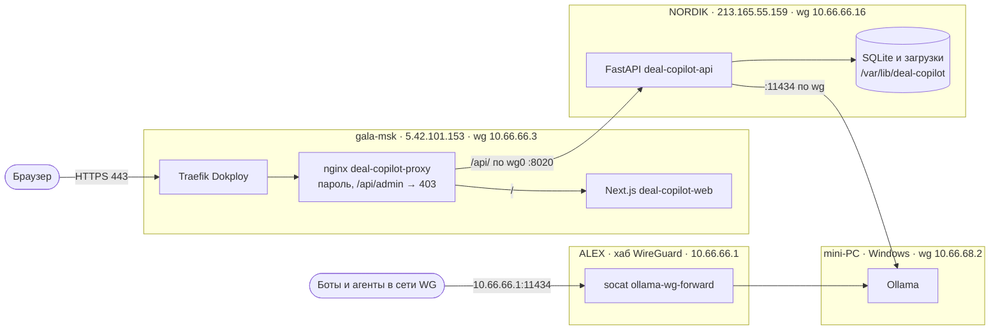

# Deal Copilot: архитектура развёртывания и восстановление

Редакция от 12 октября 2026 года, релиз `c74056d`. Документ описывает, из чего состоит
стенд, как он связан и как поднять его заново. Текущие адреса, модели и результаты
проверок — в `docs/deployment-state.md`. Секреты здесь не записываются, только где они лежат.

## Коротко

- Сайт работает на gala-msk, API и база — на NORDIK, модели — на mini-PC.
- Машины связаны сетью WireGuard; наружу открыт только сайт через HTTPS и пароль.
- Всё, что нужно для восстановления, лежит в репозитории: `deploy/install.sh` готовит
  машины, `deploy/release.sh` выкладывает код, в `deploy/` — файлы служб и прокси.
- Данные живут только на NORDIK: база SQLite и загруженные документы. Их копии
  `release.sh` делает перед каждым выпуском.

## Схема



| Машина | Что работает | Адреса |
|---|---|---|
| gala-msk | Traefik (Dokploy), контейнеры `deal-copilot-proxy` и `deal-copilot-web` | 5.42.101.153, SSH-порт 2222; wg0 10.66.66.3 |
| NORDIK | Служба `deal-copilot-api`, SQLite, сборка сайта | 213.165.55.159; wg0 10.66.66.16 |
| mini-PC (minipc-01) | Ollama, модели | wg-mini-NORDIK 10.66.68.2 |
| ALEX | Хаб WireGuard, служба `ollama-wg-forward` | конечная точка WG 5.129.218.58; wg0 10.66.66.1, SSH-порт 54922 только через WG |

## Путь запроса

1. Браузер открывает `https://deal-copilot.tools01.ru`. DNS: A-запись на 5.42.101.153
   (Timeweb). Traefik на gala-msk принимает HTTPS с сертификатом Let's Encrypt.
2. Traefik передаёт запрос контейнеру `deal-copilot-proxy` по сети `dokploy-network`.
3. Прокси спрашивает логин и пароль. `/api/admin/` закрыт всегда (403). `/api/` уходит
   на NORDIK `10.66.66.16:8020` по wg0, остальное — в контейнер сайта `deal-copilot-web:3000`.
4. API на NORDIK читает и пишет SQLite, а для извлечения требований вызывает Ollama
   на mini-PC `10.66.68.2:11434`.

Браузер к NORDIK и mini-PC напрямую не обращается: сайт собран с `NEXT_PUBLIC_API_URL=/api`.

## Сеть WireGuard

- ALEX — хаб сети 10.66.66.0/24. Участники видят друг друга через него.
- mini-PC подключён к NORDIK отдельным туннелем (`wg-mini-NORDIK`, подсеть 10.66.68.0/24).
  На ALEX у участника NORDIK в AllowedIPs есть 10.66.68.0/24, поэтому ALEX и NORDIK
  достают до mini-PC.
- У обычных участников (gala-msk, ноутбуки) AllowedIPs только 10.66.66.0/24, маршрута
  к 10.66.68.0/24 нет. Для них Ollama доступна через ALEX: `http://10.66.66.1:11434`.
- Конфигурации WireGuard в репозиторий не входят: их ведёт владелец сети. Для
  восстановления нужны маршруты, перечисленные выше.

## Порты и доступ

| Где | Порт | Кто может подключиться |
|---|---|---|
| gala-msk | 80, 443 (Traefik) | Интернет; 80 перенаправляет на 443 |
| gala-msk | 8095 (прокси) | Только `127.0.0.1` и `10.66.66.3`; запасной вход через SSH-туннель |
| NORDIK | 8020 (API) | Только gala-msk (10.66.66.3 по wg0) и локально; правила iptables ставит служба |
| mini-PC | 11434 (Ollama) | Слушает все адреса; кого пускать — решает брандмауэр Windows |
| ALEX | 11434 (socat) | Только адрес 10.66.66.1 в wg0; из интернета недоступен |

## Компоненты

### NORDIK — API и данные

- Код: `/opt/deal-copilot/releases/<commit>`, рабочая версия — ссылка `/opt/deal-copilot/current`.
- Python 3.11, виртуальное окружение внутри релиза: `backend/.venv`.
- Служба: `deploy/nordik/deal-copilot-api.service` → `/etc/systemd/system/`. Пользователь
  `dealcopilot`, uvicorn на `10.66.66.16:8020`, перезапуск при сбое, запись только
  в `/var/lib/deal-copilot`.
- Настройки: `/etc/deal-copilot/backend.env` (640, root:dealcopilot). Образец без секретов —
  `deploy/nordik/backend.env.example`.
- Данные: `/var/lib/deal-copilot/deal_copilot.db` и `/var/lib/deal-copilot/uploads/`.
- Копии: `/var/backups/deal-copilot/` — база, загрузки и настройки на момент каждого выпуска.
- Сборка сайта: `/root/deal-copilot-build/<commit>` (Node.js 22).

### gala-msk — сайт и вход

- Код: `/opt/deal-copilot/releases/<commit>`, ссылка `/opt/deal-copilot/current`.
- `deal-copilot-web`: образ `node:22-slim`, `next start` из `current/frontend` (только чтение),
  лимит памяти 512 МБ, сеть `deal-copilot-net`.
- `deal-copilot-proxy`: образ `nginx:alpine`, лимит 64 МБ, сети `deal-copilot-net`
  и `dokploy-network`. Конфигурация — `deploy/gala/nginx-default.conf` →
  `/opt/deal-copilot/proxy/default.conf`. Таймаут ответа API 900 с, загрузка до 50 МБ.
- Маршрут Traefik: `deploy/gala/traefik-deal-copilot.yml` →
  `/etc/dokploy/traefik/dynamic/deal-copilot.yml`. Traefik перечитывает каталог сам.
- Хеш пароля: `/opt/deal-copilot/proxy/htpasswd`. Открытый пароль здесь не хранится.

### mini-PC — модели

- Ollama для Windows, `OLLAMA_HOST=0.0.0.0:11434`, модели в `C:\Users\Galina\.ollama\models`.
- Список моделей, которые разрешено выбирать в Deal Copilot, задаёт
  `DEAL_COPILOT_OLLAMA_MODELS` на NORDIK. Он должен совпадать с установленными моделями:
  проверка — `curl http://10.66.68.2:11434/api/tags` с NORDIK.
- Когда mini-PC выключен, обработка документов завершается ошибкой; остальное работает.

### ALEX — Ollama для всей сети

- Служба `deploy/alex/ollama-wg-forward.service`: `socat` слушает `10.66.66.1:11434`
  и пересылает на `10.66.68.2:11434`. Нужен пакет `socat`.

## Секреты

| Секрет | Где лежит | Кто создаёт |
|---|---|---|
| Логин и пароль сайта (открытый текст) | NORDIK: `/opt/deal-copilot/secrets/web-basic-auth.txt`, 600 | `deploy/install.sh` |
| Хеш пароля сайта | gala-msk: `/opt/deal-copilot/proxy/htpasswd` | `deploy/install.sh` |
| Токен смены модели `MODEL_ADMIN_TOKEN` | NORDIK: `/etc/deal-copilot/backend.env` | `deploy/install.sh` |
| Ключ MiMo `MIMO_API_KEY` | Не задан | Владелец, при подключении MiMo |

Пароль и токен в Git, чат и журналы не попадают.

## Главные настройки API

| Переменная | Значение | Зачем |
|---|---|---|
| `DATABASE_URL` | `sqlite:////var/lib/deal-copilot/deal_copilot.db` | База вне каталога релиза |
| `UPLOAD_DIR` | `/var/lib/deal-copilot/uploads` | Оригиналы документов |
| `LLM_PROVIDER` / `DEMO_MODE` | `mock` / `true` | Облачные модели выключены; модель выбирается через административный API |
| `OLLAMA_BASE_URL` | `http://10.66.68.2:11434` | Ollama на mini-PC напрямую, без ALEX |
| `DEAL_COPILOT_OLLAMA_MODELS` | список через запятую | Какие модели можно выбрать |
| `OLLAMA_NUM_CTX` | `16384` | Контекст модели; вмещает фрагмент 12 000 символов |
| `OLLAMA_TIMEOUT_SECONDS` | `300` | Ожидание одного ответа модели |
| `CORS_ORIGINS` | `https://deal-copilot.tools01.ru` | Адрес сайта |

Активная модель хранится не в настройках, а в базе (таблица `runtime_model_selection`),
и переживает перезапуск и выпуск.

## Восстановление с нуля

### 1. Что должно быть до начала

- Машина оператора с Git Bash или Linux, клон репозитория, SSH-ключ с доступом root
  к трём серверам и такие алиасы в `~/.ssh/config` (ALEX доступен только из сети WireGuard):

```text
Host nordik
    HostName 213.165.55.159
    User root
Host gala
    HostName 5.42.101.153
    Port 2222
    User root
Host alex
    HostName 10.66.66.1
    Port 54922
    User root
```

- WireGuard работает, маршруты — как в разделе «Сеть WireGuard». Проверка:
  с gala-msk `ping 10.66.66.16`, с NORDIK `curl http://10.66.68.2:11434/api/tags`.
- NORDIK: Ubuntu, `python3.11`, `python3.11-venv`, `sqlite3`, Node.js 22 с `npm`, `iptables`.
- gala-msk: Docker, Dokploy с Traefik, сеть `dokploy-network`, сертификаты через
  `certResolver: letsencrypt`, `openssl`.
- mini-PC: Ollama слушает `0.0.0.0:11434`, нужные модели загружены, брандмауэр Windows
  пропускает порт 11434 из сети WireGuard.
- DNS: A-запись `deal-copilot.tools01.ru` → `5.42.101.153`.

### 2. Подготовить машины

Из корня репозитория:

```bash
deploy/install.sh
```

Сценарий создаёт пользователя и каталоги на NORDIK, настройки с новым токеном, службу API;
на gala-msk — прокси, пароль сайта (открытый текст кладёт на NORDIK), маршрут Traefik;
на ALEX — пересылку Ollama. Уже существующие настройки, пароль и токен не трогает.

Если адреса или модели другие, до запуска поправьте `deploy/nordik/backend.env.example`
или после запуска — `/etc/deal-copilot/backend.env` на NORDIK.

### 3. Выложить код

```bash
deploy/release.sh main
```

Сценарий собирает API и сайт из указанной версии, делает копию данных, переключает
ссылку `current` и перезапускает службу и контейнер. При первом выпуске создаёт контейнер
сайта. Если `known_hosts` недоступен, передайте свой файл: `KNOWN_HOSTS=<путь> deploy/release.sh main`.

### 4. Вернуть данные из копии

Если NORDIK поднимается заново, а копия сохранилась:

```bash
systemctl stop deal-copilot-api
install -o dealcopilot -g dealcopilot -m 644 <КОПИЯ>.db /var/lib/deal-copilot/deal_copilot.db
tar -xzf <КОПИЯ_ЗАГРУЗОК>.tgz -C /var/lib/deal-copilot && chown -R dealcopilot:dealcopilot /var/lib/deal-copilot
systemctl start deal-copilot-api
```

База и загрузки должны быть из одного момента: в базе записаны пути к файлам.

### 5. Выбрать модель

Только на NORDIK, токен — из настроек:

```bash
T=$(grep ^MODEL_ADMIN_TOKEN= /etc/deal-copilot/backend.env | cut -d= -f2-)
curl -s -H "X-Model-Admin-Token: $T" http://10.66.66.16:8020/api/admin/model-profiles
curl -s -X PUT -H "X-Model-Admin-Token: $T" -H 'Content-Type: application/json' -d '{"profile_code":"ollama:qwen2.5:14b"}' http://10.66.66.16:8020/api/admin/model-profile
```

Проверено: `qwen2.5:14b` извлекает площадь и срок правильно, `qwen2.5:7b` — нет.

### 6. Проверить

| Проверка | Как | Ожидается |
|---|---|---|
| API | на NORDIK: `curl http://10.66.66.16:8020/api/health` | `"status":"ok"`, `"model_configured":true` |
| Закрытый порт API | с любой машины, кроме gala-msk: `curl -m5 http://10.66.66.16:8020/api/health` | нет ответа |
| Сайт без пароля | `curl -I https://deal-copilot.tools01.ru` | 401 |
| Административный API снаружи | `https://deal-copilot.tools01.ru/api/admin/model-profiles` с паролем | 403 |
| Ollama для сети | с gala-msk: `curl http://10.66.66.1:11434/api/tags` | список моделей |
| Сквозная проверка | создать сделку, загрузить ТЗ, «Распознать и извлечь требования» | площадь и срок найдены, в «Контроль обработки» есть шаг `ai_extraction` |

## Обычные операции

- **Выпуск:** `deploy/release.sh <ветка или commit>`.
- **Откат:** на NORDIK и gala-msk переключить ссылку `/opt/deal-copilot/current` на прежний
  каталог в `releases`, затем `systemctl restart deal-copilot-api` и
  `docker restart deal-copilot-web`. Если менялись настройки — вернуть `backend.env`
  из `/var/backups/deal-copilot/`.
- **Копия без выпуска:**

```bash
sqlite3 /var/lib/deal-copilot/deal_copilot.db ".backup /var/backups/deal-copilot/deal_copilot-$(date +%F).db" && tar -czf /var/backups/deal-copilot/uploads-$(date +%F).tgz -C /var/lib/deal-copilot uploads
```

- **Добавить или убрать модель:** загрузить или удалить её в Ollama на mini-PC, поправить
  `DEAL_COPILOT_OLLAMA_MODELS` на NORDIK, `systemctl restart deal-copilot-api`. Активную
  модель сначала переключите на другую.
- **Сменить пароль сайта:** удалить `/opt/deal-copilot/proxy/htpasswd` на gala-msk, выполнить
  `deploy/install.sh`, затем `docker restart deal-copilot-proxy`. Новый пароль появится
  на NORDIK в `/opt/deal-copilot/secrets/web-basic-auth.txt`.
- **Журналы:** API — `journalctl -u deal-copilot-api` на NORDIK; сайт и прокси —
  `docker logs deal-copilot-web` и `docker logs deal-copilot-proxy` на gala-msk;
  сертификат — `docker logs dokploy-traefik`.

## Ограничения и риски

- **Одна учётная запись на всех.** Прав пользователей в приложении нет; кто знает пароль,
  может удалять сделки и менять прайс-лист.
- **Модели зависят от mini-PC.** Выключенный компьютер или перезапуск Ollama останавливают
  обработку документов. Набор моделей на mini-PC может меняться — сверяйте его со списком
  на NORDIK.
- **Длинная обработка идёт одним запросом.** Большое ТЗ обрабатывается минутами; прокси
  ждёт до 900 с.
- **Копии лежат на той же машине,** что и данные. Для защиты от потери NORDIK их нужно
  уносить на другую машину.
- **Порт Ollama на mini-PC** открыт брандмауэром Windows для любых адресов, включая
  домашнюю сеть. Сузить до подсетей WireGuard может только владелец машины.
